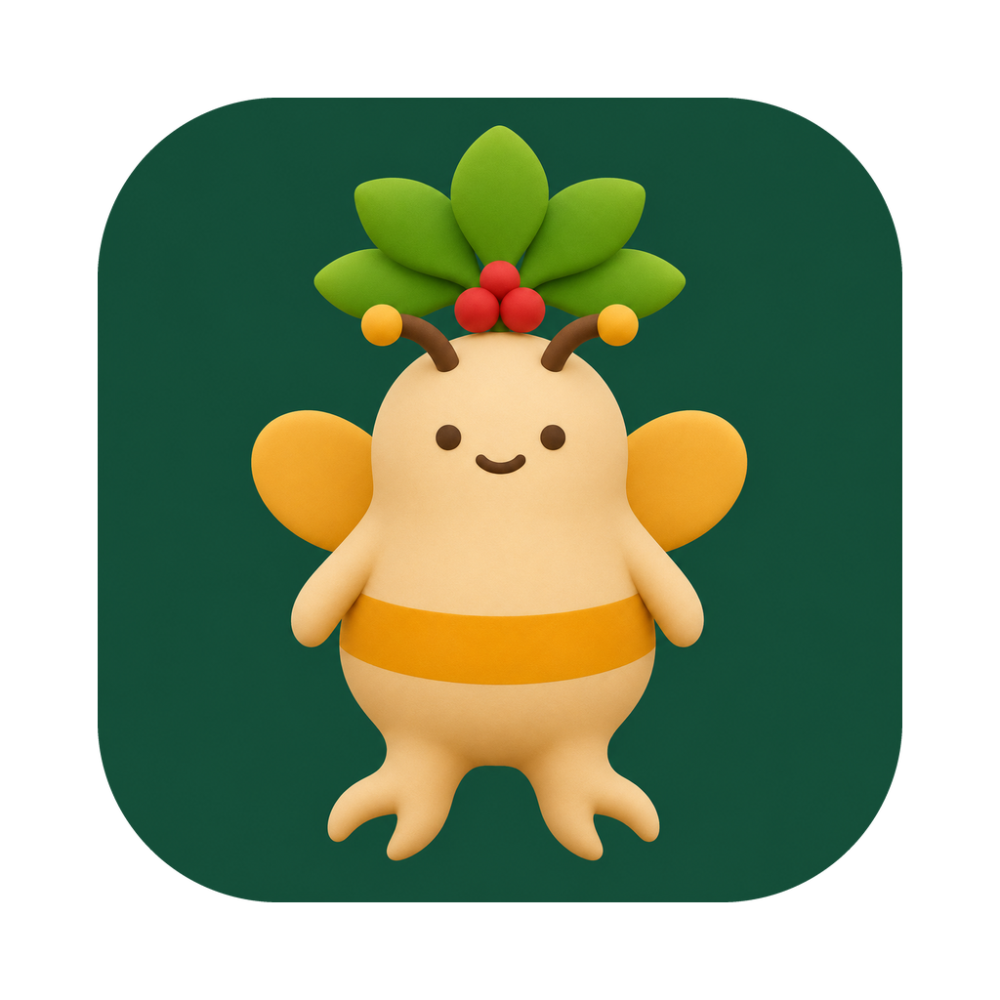

<div align="center">



# 창업논문 도우미

**한국농수산대학교 창업논문·영농계획서를 학교 공식 작성지침에 맞춰 쓰고 검토하는 도구입니다.**

AI 도우미가 질문을 던지며 함께 쓰고, 앱은 그동안 무엇이 확인됐고 무엇이 안 됐는지를 보여줍니다.

[**설치본 내려받기**](../../releases/latest) · [사용 안내](docs/학생용-사용안내.md) · [설치가 막힐 때 (macOS)](docs/설치-안내-macOS.md) · [설치가 막힐 때 (Windows)](docs/설치-안내-Windows.md)

</div>

> [!WARNING]
> **초기 베타입니다.** 아직 실사용 검증이 충분하지 않습니다. 실제 제출용 논문에 쓰시기 전에 **원본 답변·자료를 따로 백업**해 두세요. 서명이 없어 macOS 가 처음 한 번 실행을 막습니다.

---

## 이 도구가 하는 일

- 학교 공식 PDF 지침과 내가 쓴 원답변을 **근거로 삼아** 창업논문 Ⅰ~Ⅵ장을 씁니다.
- **사실·목표·가정·계산을 구분해서** 관리합니다. 원문 근거가 없는 주장은 자동으로 통과시키지 않습니다.
- 재무계획 엑셀(XLSX)과 논문 워드(DOCX)를 만들고, 학교 원문에서 분해한 지침 항목과 대조합니다.
- 잔류 잠금 해제·정본 스냅샷 복원 같은 사고 수습도 버튼으로 됩니다.

## 이 도구가 하지 않는 일

이게 더 중요합니다.

- **지도교수 승인을 대신하지 않습니다.** 앱은 승인 여부를 판정하지 않고, 기록만 보여줍니다.
- **자동 점검 통과를 "완료"로 바꾸지 않습니다.** 확인은 네 갈래(자동 점검 / 다른 사람 검토 / 파일 확인 / 교수님 승인)로 **끝까지 따로** 표시됩니다. 하나의 체크표시로 합치지 않습니다.
- **모르는 것을 안다고 하지 않습니다.** 확인 못 한 항목은 "보류"로 남고, 통과로 세지 않습니다.
- **아무것도 기기 밖으로 보내지 않습니다.** 앱 안에는 AI가 없습니다. 논문을 쓰는 건 사용자가 직접 로그인한 AI 도우미(Claude Code 또는 ChatGPT)이고, 그 대화만 해당 서비스로 갑니다.

최종 책임은 항상 작성자 본인에게 있습니다.

## 화면

도우미와 대화하며 논문을 씁니다. 앱은 진행 상황을 옆에서 보여줍니다.
여러 칸으로 된 질문에는 각 칸을 채우거나 미정을 선택한 뒤 보냅니다. 보낸 답은 대화에 남습니다.


확인 상태는 네 갈래로 따로 섭니다. 아래는 아직 아무것도 끝나지 않은 상태입니다.


만든 파일은 결과물 화면에 모입니다.


## 학생이라면 — 설치

**macOS**

1. [릴리스 페이지](../../releases/latest)에서 `.dmg` 를 받습니다.
2. 열어서 앱을 **응용 프로그램** 폴더로 끌어다 놓습니다.
3. 처음 열 때 "확인되지 않은 개발자" 경고가 나오면 [설치 안내 (macOS)](docs/설치-안내-macOS.md)를 따라 주세요.

**Windows 10/11 (64비트)**

1. [릴리스 페이지](../../releases/latest)에서 `knuaf-dev-….exe` 를 받습니다. **Chrome으로 받기를 권합니다** (Edge에서 "일반적으로 다운로드되지 않습니다"로 막히면 `…` 메뉴에서 **유지**를 누르거나 Chrome으로 받아 주세요).
2. 실행합니다. **"Windows의 PC 보호"** 창이 뜨면 **추가 정보 → 실행** 을 누릅니다.
3. 설치 창에서 **설치** 를 누릅니다. 사진과 함께 보려면 [설치 안내 (Windows)](docs/설치-안내-Windows.md)를 보세요.

> 아직 Apple 개발자 서명과 Windows 코드 서명 인증서가 없어 두 OS 모두 처음 한 번 막습니다. 한 번만 허용하면 그다음부터는 그냥 열립니다.

Python·라이브러리 설치는 앱이 알아서 합니다. 따로 준비할 것은 없습니다.

## 에이전트 스킬로만 쓰려면

앱 없이 Codex CLI나 Claude Code에 스킬로 붙여 쓸 수도 있습니다. **Python 3.10 이상이 필요합니다** — macOS 기본 `python3`(3.9)로는 첫 명령에서 안내와 함께 종료됩니다.

원본 독립 스킬은 [knuaf-doc](https://github.com/starceas/knuaf-doc)에서 제공합니다. 이 저장소에는 별도의 구판 스크립트 사본을 두지 않습니다.

앱 전용 `knuaf-dev`를 쓰려면 먼저 아래 개발 절차의 `stage:skill`을 통과해야 합니다.
그 결과인 `app/resources/skill/`을 Claude Code의 스킬 폴더로 복사하거나, 생성된 묶음이 있는 **로컬 저장소**를 플러그인으로 등록합니다. Claude·Codex 플러그인 모두 같은 생성 경로를 사용합니다. 원격 저장소 등록만으로 묶음이 생기지는 않습니다.

실행 의존성은 생성된 `app/resources/skill/scripts/requirements-runtime.txt`에 있습니다 (`openpyxl`, `python-docx`, `pypdf`). Windows 네이티브 Office에는 `pywin32`도 필요합니다.

## 플랫폼

핵심 로직은 knuaf-doc 원본에서 공급합니다. 앱은 명시 전공·출력 보호·잠금 계약을 약화하지 않고 호출합니다. 기존 학생 프로젝트의 legacy 잠금은 자동 삭제하거나 새로 init하지 않습니다.

마지막 단계인 "네이티브 Office로 실제 재계산·페이지 렌더까지 확인"만 플랫폼을 탑니다.

| 플랫폼 | 구현 | 실사용 검증 |
|---|---|---|
| macOS | 격리된 native Office 변환 | 기존 앱 판의 실측은 있으나 새 compose 묶음의 native 변환은 미검증 |
| Windows | COM 자동화(pywin32) | **아직 없음.** 코드와 정적 검사만 있습니다 |

Windows에서 써보시고 문제를 만나면 이슈로 알려주세요.

## 개발

```bash
python3.13 -m venv .venv-dev
pnpm -C app install --frozen-lockfile --offline
.venv-dev/bin/pip install pytest pytest-timeout -r "$(node app/scripts/fetch-skill.mjs --requirements)"
node app/scripts/test-with-skill.mjs --offline --python .venv-dev/bin/python
```
`stage:skill`은 `app/skill-source.json`의 정확한 commit/tag만 사용하고 최종 compose bytes로 소비자·원본 내부 시험·이관한 보호별 원본 루트 시험을 실행합니다. 실패하면 이전 동봉 묶음을 보존하고 build도 중단합니다. 현재 고정은 v0.4.2(`60311c1…`)입니다. pin을 바꾸면 시험 제외나 원본 정책 수정 없이 같은 전체 게이트를 다시 통과해야 합니다.

개인 `.harness.conf`는 추적하지 않습니다. 기존 `HARNESS_TEST=.venv-dev/bin/python -m pytest`도 추적된 `tests/conftest.py`의 세션 시작에서 고정 pin을 오프라인으로 준비합니다. 준비가 성공해야 시험 수집으로 넘어가며 실패는 명시적인 비0 종료입니다. 개인 훅·공유 하네스 설정을 바꾸지 않아도 같은 트리의 새 사본에 적용됩니다. CI는 `test-with-skill.mjs`로 같은 stage를 먼저 실행하고 pin별 캐시를 복원합니다. 준비된 런타임을 명시한 내부 시험은 재귀 준비를 하지 않습니다.
캐시는 `app/resources/skill-upstreams/<commit>/`입니다. 오프라인 의존성 경로 확인은 `node app/scripts/fetch-skill.mjs --offline --requirements`로 합니다. `KNUAF_SKILL_UPSTREAM`에는 고정 commit/tag와 일치하는 로컬 checkout을 지정할 수 있습니다. HEAD/tag·수정/추가/무시 파일뿐 아니라 고정 commit의 blob ID와 실제 파일 바이트를 직접 대조하므로 index의 숨김 플래그로 시험 변조를 감출 수 없습니다. 검증 시 읽은 바이트를 격리 사본으로 만들어 compose·호환 시험이 같은 입력을 사용합니다. 새 clone은 `core.autocrlf=false`, `core.eol=lf`로 준비하며 캐시 안에서 시험을 직접 실행하지 않습니다.
pytest 옵션은 `--` 뒤에 전달합니다: `node app/scripts/test-with-skill.mjs --offline --python .venv-dev/bin/python -- -q`. 6ba5b6c 등의 로컬 compose 검증만 하려면 `KNUAF_TEST_SCRIPTS_DIR=/절대/묶음/scripts .venv-dev/bin/python -m pytest`를 별도로 사용합니다. 이 검증 경로는 고정 pin 준비·정식 동봉의 우회 경로가 아닙니다.


앱은 [app/README.md](app/README.md) 를 보세요. CI는 ubuntu/macos/windows × Python 3.10/3.13 에서 같은 테스트를 돌립니다.

## 학교 공식 지침 원문

저작권이 불확실한 학교 공식 PDF·발췌본은 이 저장소에 **들어 있지 않습니다.** 사용자가 자신의 학교 공식 원문을 직접 준비해서 등록해야 합니다.

## 라이선스

MIT — [LICENSE](LICENSE). 원본 스킬은 [starceas/knuaf-doc](https://github.com/starceas/knuaf-doc) 입니다.
